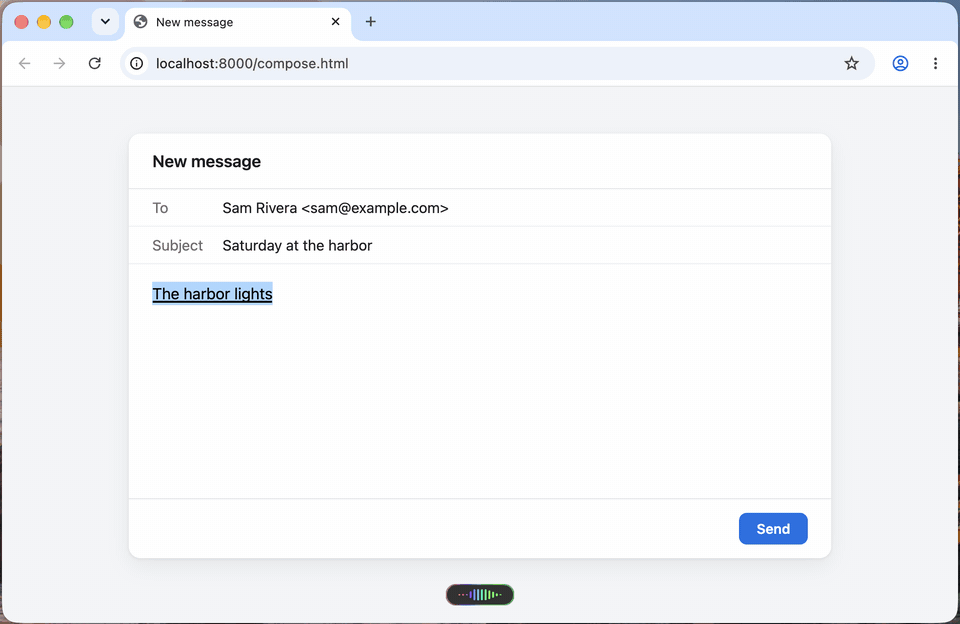
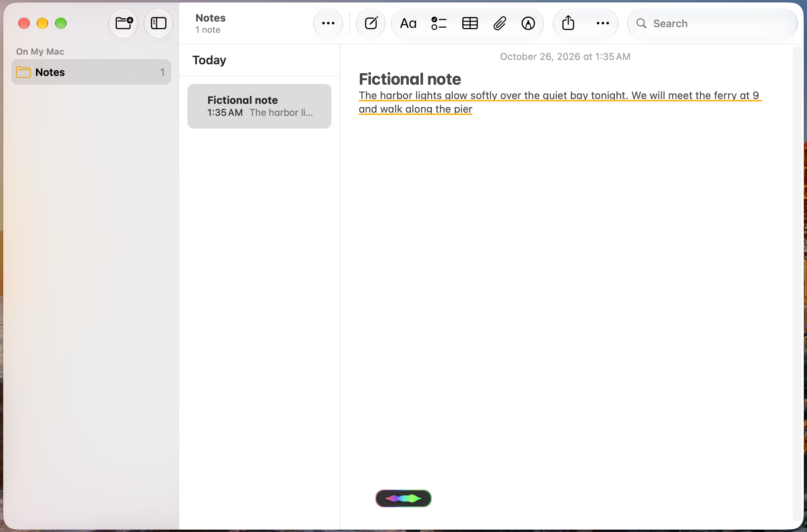
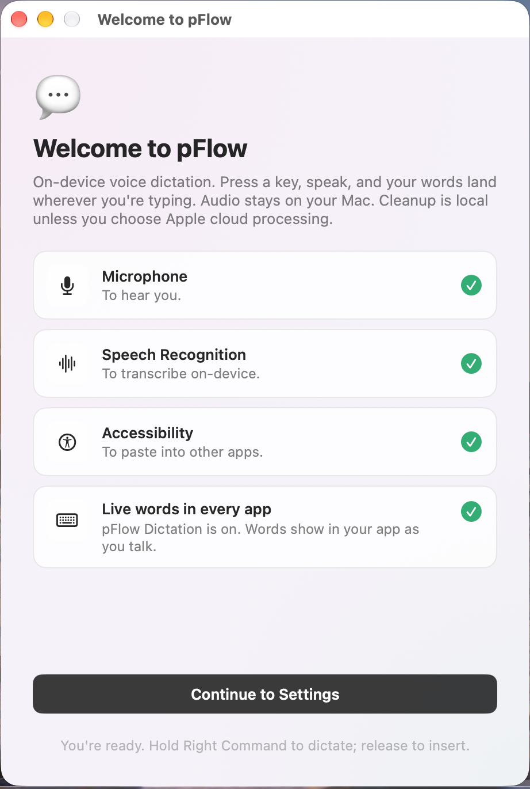
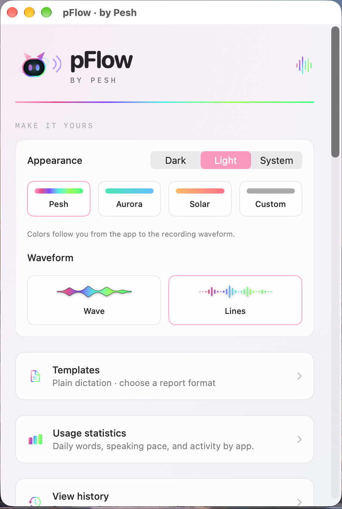

# pFlow: free dictation for Mac that shows your words as you talk

pFlow is a free, open-source dictation app for macOS. Hold Right Command and talk. Your words appear in the app you're typing in while you speak, the way Apple Dictation shows them, in Chrome, Safari, Messages, Notes, VS Code and more. Let go, and pFlow puts in the finished, punctuated text once.

It runs on your Mac. No account, no subscription, no word limit.

**[Download pFlow for Mac 0.3.17](https://github.com/PESHian/pFlow/releases/download/pflow-desktop-2026.10.25.1/pFlow-Mac-0.3.17.dmg)** · Apple Silicon · macOS 27 or later · [All releases](https://github.com/PESHian/pFlow/releases)

<picture><source media="(prefers-color-scheme: dark)" srcset="https://raw.githubusercontent.com/PESHian/pFlow/main/docs/images/demo-dark.gif"></picture>

## Why pFlow

- **Words as you talk, in every app.** pFlow shows your words in the field you're typing in, not in a separate window. It works in web apps and in Electron apps like VS Code too.
- **Fast.** The first words show about 1.2 seconds after you start talking.
- **Private.** Your speech is recognized on your Mac. Cleanup uses Apple Intelligence on your Mac when it's available. pFlow has no account, no servers and no tracking.
- **Free and open source.** MIT licensed. No trial, no weekly word cap, no ads.
- **Careful with your text.** pFlow never types into password fields. If you click, type or switch apps mid-sentence, it stops and keeps your words in History. If it can't be sure where your words went, it doesn't paste; it shows them on a Copy card instead. Your clipboard is put back after a paste.
- **Made to fit how you write.** A dictionary for names and terms, templates, local history, daily and per-app stats, and a small capsule with a Wave or Lines waveform in your colors.

<picture><source media="(prefers-color-scheme: dark)" srcset="https://raw.githubusercontent.com/PESHian/pFlow/main/docs/images/live-notes-dark.png"></picture>

## A free alternative to Wispr Flow and Superwhisper

Paid dictation apps charge for this. Wispr Flow Pro is $15 a month, or $12 a month billed yearly, and its free plan stops at 2,000 words a week on desktop. Superwhisper's Pro features are a paid plan too. pFlow shows your words live in every Mac app for free, and its code is open for anyone to read.

Prices from [wisprflow.ai/pricing](https://wisprflow.ai/pricing) and [superwhisper.com](https://superwhisper.com), checked October 25, 2026.

## Install on a Mac

1. Download [pFlow-Mac-0.3.17.dmg](https://github.com/PESHian/pFlow/releases/download/pflow-desktop-2026.10.25.1/pFlow-Mac-0.3.17.dmg). You can check it against the `.sha256` file on the release page.
2. Open the disk image and drag **pFlow by Pesh** into Applications.
3. Open pFlow. This build isn't notarized by Apple yet, so macOS may block it the first time. Go to **System Settings › Privacy & Security** and choose **Open Anyway** ([Apple's steps](https://support.apple.com/en-us/102445)).
4. pFlow's setup page opens. Allow **Microphone** and **Speech Recognition**, and press **Grant** next to **Accessibility**.
5. For words as you talk in every app, add **pFlow Dictation** once. Press its button on the setup page, or go to **System Settings › Keyboard › Text Input › Edit… › + › English › pFlow Dictation › Add**.

<picture><source media="(prefers-color-scheme: dark)" srcset="https://raw.githubusercontent.com/PESHian/pFlow/main/docs/images/setup-dark.png"></picture> <picture><source media="(prefers-color-scheme: dark)" srcset="https://raw.githubusercontent.com/PESHian/pFlow/main/docs/images/appearance-dark.png"></picture>

## Use it

- **Hold Right Command** and talk. Let go to finish.
- **Double-tap Right Command** to keep talking hands-free. Tap it once to stop.
- Left Command still works for your shortcuts.
- Want another key? In Settings → Shortcut, pick Right Control, or choose **Press a key…** and press the one you want, like an F key (on a laptop, hold fn as you press it). Keys that type (Option and Shift among them) and Escape, which stops a dictation, can't be chosen.
- At the start and end of each dictation, macOS shows a small keyboard label at the cursor. That's pFlow switching to pFlow Dictation and back to your keyboard.
- If double-tapping opens Siri or Apple's Dictation, change its keyboard shortcut in System Settings so it doesn't use your key twice.
- Speech engine: Apple's on-device engine is the default. You can pick Whisper (whisper.cpp, also on your Mac) in Settings; it downloads a checksum-checked model the first time.

## Features

- Live words in the app as you talk, through pFlow Dictation, a small input method that comes inside pFlow. Fields that can't show them get pFlow's own small preview instead.
- The finished text goes in once at the end, with punctuation and your dictionary.
- Cleanup and report formatting with Apple Intelligence when it's available. Plain dictation works without it.
- Dictionary, templates and optional bold headings.
- Local history with daily and per-app statistics.
- Wave or Lines waveform; Pesh, Aurora, Solar or custom colors; light, dark or system appearance.
- Optional copy to clipboard, and launch at login.

## Update

Download the newest version from [Releases](https://github.com/PESHian/pFlow/releases), quit pFlow, and drag the new one into Applications (choose **Replace**). Your settings, history, dictionary and templates stay.

Until pFlow is signed with an Apple Developer ID:
- macOS treats each new version as a new app, so press **Grant** for Accessibility again after you update.
- The in-app update button can't install new Mac versions. Get them from Releases.

Coming from Mac 0.3.6 or older, when the app was called Yap? Replace it the same way. If **System Settings › Privacy & Security › Accessibility** still lists Yap, select it, click **−**, then open pFlow and allow it again.

## Privacy

- Your speech is recognized on your Mac, by Apple's on-device speech engine or by Whisper if you pick it.
- Cleanup and formatting use Apple Intelligence on your Mac. Source builds with Apple's required entitlement can opt into Apple Private Cloud Compute, which sends text and formatting instructions to Apple; the Mac download on this page has no cloud entitlement.
- pFlow has no account, no analytics and no servers. It checks for updates only when you ask.
- History and settings stay in your Mac user account. Delete History entries you don't need.
- Speech models come from their hosts: Apple for its speech engine, and the Whisper model download if you choose Whisper.
- pFlow keeps no log unless you turn on **Settings → Troubleshooting → Troubleshooting log**. Then it notes each step it takes (for example, why words couldn't go in), never your words, and **Save log…** puts it in a file you can send. Turning it off deletes the log.

This public repository holds the app's source, artwork, licenses and fictional test fixtures. It contains no user settings, saved dictations, personal recordings or credentials.

## How it was tested

pFlow 0.3.17 was tested with recorded speech in TextEdit, Notes, Safari, Chrome (plain boxes and rich editors), Reminders, T3 Code, VS Code and LibreOffice, both holding and double-tapping Right Command: in 230 dictations the finished text went in exactly once every time. It was then used with live speech on a real Mac across everyday apps.

Known: now and then, mostly on a quick second dictation, the words show in pFlow's small preview instead of in the app. The finished text still goes in once.

## Windows (testing)

pFlow for Windows is in testing. The latest test build is `pFlow-Setup-0.1.28-testing.exe` on the [testing release](https://github.com/PESHian/pFlow/releases/tag/pflow-desktop-2026.10.19.6), for x64, ARM64 or x86 on Windows 10 1607+ or Windows 11. See the [installation steps](windows/INSTALLATION.txt) and [Windows details](windows/README.md), including what has been tested. The Windows app isn't code-signed yet. Mac and Windows use different AI formatting engines and aren't claimed to behave the same.

## Build from source

Mac: install Xcode with the macOS 27 SDK and [XcodeGen](https://github.com/yonaskolb/XcodeGen), run `xcodegen generate`, then build the Yap scheme from `Yap.xcodeproj`; it produces `pFlow.app`. `scripts/build-whisper.sh` prepares the pinned local engine. `release.sh` supports Developer ID signing/notarization when you supply your own credentials.

For trusted Mac candidates, follow the [signing setup and release checks](updates/MAC-RELEASE.md). Production packaging requires an approved Developer ID identity and notarization access. Development builds cannot use the production updater.

Windows: install .NET 10 SDK, CMake, and Visual Studio C++ tools for your architecture, then run `windows/scripts/build-windows.ps1`. See [Windows details](windows/README.md). Use `-Architecture x64`, `-Architecture arm64`, or `-Architecture x86`. ARM64 native compilation uses the Clang C++ toolset; the other builds use MSVC with a static speech runtime. The published Windows binaries omit debug symbols. Release builds are checked for personal build paths; source builds need the same checks before distribution. Each architecture needs its own build and verification.

## License and attribution

pFlow is based on [Yap by Frigade](https://github.com/FrigadeHQ/yap), under the [MIT License](LICENSE). The original copyright and license notice are retained. Pesh artwork and pFlow changes are distributed under the same license. whisper.cpp, its audio/model components, llama.cpp, Qwen, .NET, and Swift dependencies retain their own included licenses. Model downloads must keep their accompanying notices.
